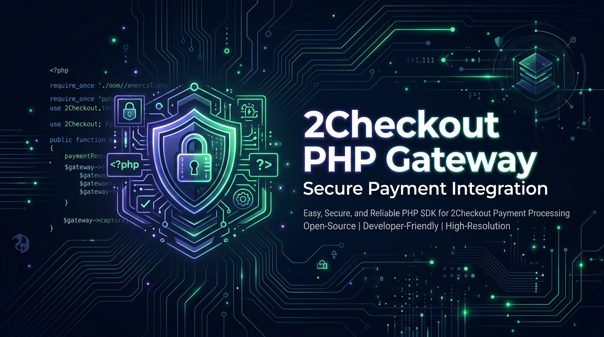
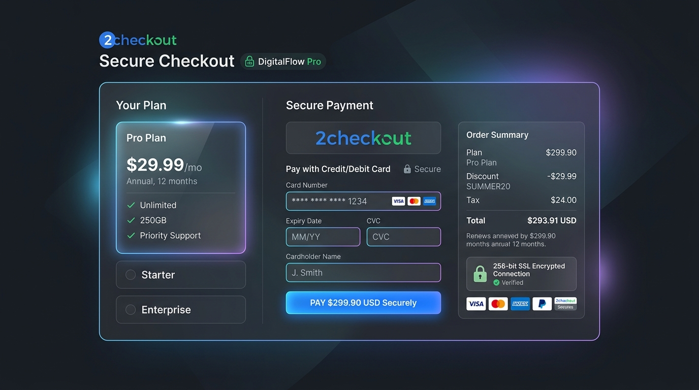
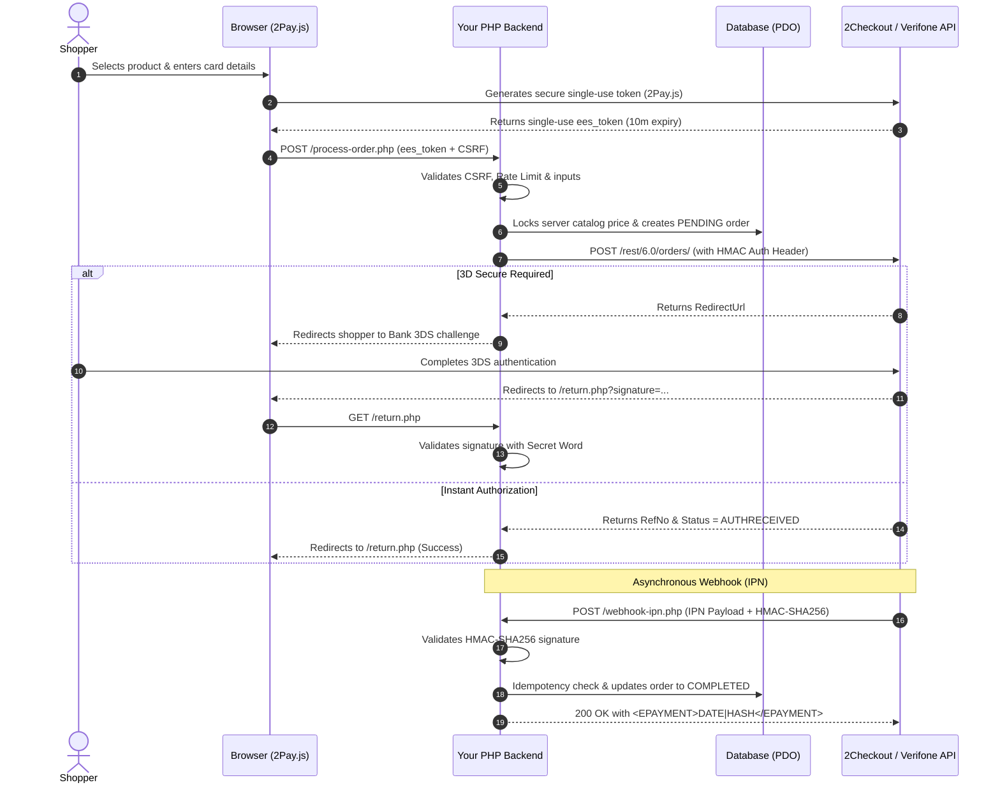

<div align="center">



<br /><br />

# 🔒 Secure 2Checkout (Verifone) Payment Gateway for PHP

[](https://www.php.net/)
[](LICENSE)
[](#-security-architecture)
[](https://verifone.cloud/docs/2checkout)
[-success?style=for-the-badge)](#-zero-external-dependencies)

<p align="center">
  <b>A modern, production-hardened 2Checkout (Verifone) payment gateway integration built for maximum security, compliance, and developer ease.</b>
  <br />
  Includes <b>2Pay.js</b> client-side tokenization, <b>HMAC-SHA256 IPN</b> webhook verification with mandatory read-receipts, <b>3D Secure 2.0</b> handling, <b>anti-CSRF</b>, <b>IP rate limiting</b>, and <b>server-side price locking</b>.
</p>

[Key Features](#-key-features) •
[Interface Preview](#-checkout-interface-preview) •
[Security Architecture](#-security-architecture) •
[Sequence Flow](#-sequence-flow) •
[Quick Start](#-quick-start) •
[2Checkout Portal Setup](#-2checkout-control-panel-setup) •
[Test Cards](#-test-cards) •
[Production Checklist](#-production-hardening-checklist)

---

</div>

## 🖥️ Checkout Interface Preview

<div align="center">
  
</div>

---

## 🌟 Key Features

- **PCI-DSS SAQ-A Compliant**: Uses 2Checkout's official **2Pay.js** library to securely collect card details inside isolated iframes. Sensitive card numbers (PAN) and CVVs **never hit your server**.
- **HMAC-SHA256 IPN (Webhook) Verification**: Implements 2Checkout's exact byte-length prefix serialization algorithm (`strlen()`) with constant-time verification (`hash_equals()`) to eliminate timing attacks.
- **Mandatory Read-Receipt Response**: Automatically issues `<EPAYMENT>{date}|{hash}</EPAYMENT>` acknowledgments to prevent 2Checkout from triggering duplicate webhook retry storms.
- **Buy-Link Secret Word Return Validation**: Verifies customer redirect parameters (`signature`) after Hosted or 3DS checkout using case-insensitive alphabetical sorting and SHA256 HMAC.
- **Server-Side Price & Currency Integrity**: Order pricing is validated strictly against an internal catalog or database; client-submitted prices are discarded.
- **Cryptographic Anti-CSRF Protection**: Per-session 256-bit entropy tokens with automatic expiry and constant-time validation on all POST requests.
- **Anti-Card Stuffing / Rate Limiting**: Token-bucket sliding window rate limiter tracking client IP to protect endpoints against automated card-testing bots.
- **Idempotency & Replay Defense**: Atomic transaction and IPN event logging prevents duplicate fulfillment on network retries.
- **Sensitive Data Redaction**: Automatic audit logger scrubs PANs, tokens, CVVs, and secret keys from logs.
- **Modern Responsive UI**: Clean, responsive, dark-mode checkout interface built with vanilla HTML/CSS and zero framework bloat.
- **Zero External Dependencies**: Runs out-of-the-box using PHP core extensions (`curl`, `pdo`, `json`, `openssl`).

---

## 🛡️ Security Architecture

| Defense Layer | Implementation | Security Objective |
| :--- | :--- | :--- |
| **Client Tokenization** | `2Pay.js` | Keeps merchant infrastructure completely out of PCI-DSS scope (SAQ-A). |
| **REST API 6.0 Client** | `X-Avangate-Authentication` Header | Requests authenticated using HMAC calculated with API Secret Key and merchant code. |
| **Webhook Verification** | `IpnHandler.php` | Full recursive serialization with byte length (`strlen()`) to prevent UTF-8 multibyte exploits. |
| **Return URL Verification** | `ReturnValidator.php` | Prevents malicious users from spoofing payment success by tampering with GET query parameters. |
| **Price Tamper Defense** | `OrderService.php` | Enforces server-side product catalog locking. Clients cannot override amounts or currencies. |
| **Anti-CSRF Defense** | `Security.php` | 256-bit cryptographically secure session tokens prevent cross-site request forgery. |
| **Database Security** | PDO (`PDO::ATTR_EMULATE_PREPARES => false`) | Prevents SQL injection across SQLite and MySQL backends. |
| **Rate Limiter** | Sliding window IP limiter | Stops brute-force card testing and denial-of-service attempts. |
| **HTTP Hardening** | Strict CSP, HSTS, X-Frame-Options | Prevents clickjacking, MIME sniffing, and unauthorized script injection. |

---

## 🔄 Sequence Flow



---

## 📁 Repository Structure

```
├── config/
│   └── config.php               # Bootstrap, PSR-4 autoloader, exception handler
├── src/
│   ├── Config.php               # Environment configuration manager
│   ├── Database.php             # PDO database connection & schema (SQLite / MySQL)
│   ├── Security.php             # CSRF, rate-limiting, sanitization, security headers
│   ├── Logger.php               # Sensitive data redaction & audit logger
│   ├── OrderService.php         # Server-side catalog, order lifecycle, idempotency
│   └── TwoCheckout/
│       ├── ApiClient.php        # REST API 6.0 client with HMAC request headers
│       ├── IpnHandler.php       # IPN HMAC-SHA256 verifier & <EPAYMENT> generator
│       └── ReturnValidator.php  # Buy-Link return URL HMAC verifier
├── public/
│   ├── index.php                # Modern checkout page with 2Pay.js card component
│   ├── process-order.php        # Backend order authorization & 3DS router
│   ├── webhook-ipn.php          # 2Checkout IPN webhook listener
│   ├── return.php               # Payment confirmation landing page
│   ├── cancel.php               # Transaction cancellation page
│   ├── css/style.css            # Dark glassmorphic responsive styles
│   └── js/checkout.js           # 2Pay.js card mounting & AJAX submission
├── storage/
│   ├── database.sqlite          # Auto-created SQLite database file
│   ├── logs/                    # Audit logs (.htaccess protected)
│   └── .htaccess                # Apache directory lock (Deny from all)
├── tests/
│   └── test_gateway.php         # Automated security & cryptographic verification suite
├── .env.example                 # Environment configuration template
├── .gitignore                   # Git ignore file protecting keys, logs, and database
├── composer.json                # Composer configuration (PSR-4 autoloading)
└── README.md                    # Project documentation
```

---

## 🚀 Quick Start

### 1. Requirements
- **PHP**: 7.4 or 8.0+
- **Extensions**: `curl`, `json`, `pdo`, `pdo_sqlite` (or `pdo_mysql`), `openssl`

### 2. Installation
Clone the repository:
```bash
git clone https://github.com/yourusername/2checkout-php-gateway.git
cd 2checkout-php-gateway
```

### 3. Configure Environment Variables
Copy `.env.example` to `.env`:
```bash
cp .env.example .env
```

Open `.env` and configure your 2Checkout credentials:
```env
# Mode: 'sandbox' or 'production'
TCO_ENV=sandbox

# Merchant Code / Seller ID (Found in 2Checkout: Integrations -> Webhooks & API)
TCO_MERCHANT_CODE=YOUR_MERCHANT_CODE

# REST API Secret Key (Found in: Integrations -> Webhooks & API -> Secret Key)
TCO_SECRET_KEY=YOUR_REST_API_SECRET_KEY

# Buy-Link Secret Word (Found in: Integrations -> Webhooks & API -> Secret Word)
TCO_SECRET_WORD=YOUR_BUY_LINK_SECRET_WORD

# IPN Secret Key (Usually same as Secret Key or Secret Word)
TCO_IPN_SECRET_KEY=YOUR_IPN_SECRET_KEY

# Application Public URL (No trailing slash)
APP_URL=http://localhost:8000
APP_DEBUG=true

# Database Driver (sqlite or mysql)
DB_DRIVER=sqlite
DB_SQLITE_PATH=storage/database.sqlite
```

### 4. Run Locally
Start the PHP built-in web server targeting the `public/` directory:
```bash
php -S localhost:8000 -t public
```
Visit **`http://localhost:8000`** in your browser.

---

## 🧪 Automated Security Verification Suite

This repository includes a standalone test script that verifies every cryptographic algorithm and security control without needing third-party testing frameworks:

```bash
php tests/test_gateway.php
```

### What the test suite verifies:
- [x] **CSRF Token Entropy & Constant-Time Validation**: Confirms 256-bit token generation and rejection of tampered tokens.
- [x] **Input Sanitization & Validation**: Tests email, ISO country, ISO currency, and price validators.
- [x] **2Checkout IPN HMAC-SHA256 Serialization**: Tests byte-length prefixes, multidimensional array recursion, signature verification, and tampered payload rejection.
- [x] **`<EPAYMENT>` Read-Receipt**: Verifies the exact format and hash of the acknowledgment receipt.
- [x] **Return URL Buy-Link HMAC Validation**: Verifies alphabetical parameter sorting and signature checking.
- [x] **REST API 6.0 HMAC Authentication Header**: Validates `code`, `date`, and `hash` generation.
- [x] **Database Schema & Idempotency**: Tests order creation, catalog price lock, order state transition, and duplicate IPN replay skipping.
- [x] **Sensitive Data Redaction**: Validates that PANs, CVVs, tokens, and secret keys are automatically scrubbed from logs.

---

## ⚙️ 2Checkout Control Panel Setup

### 1. Instant Payment Notification (IPN) Webhook
1. Log in to your **2Checkout Merchant Control Panel**.
2. Go to **Integrations** &rarr; **Webhooks & API**.
3. Scroll down to **IPN Settings**:
   - **IPN URL**: `https://yourdomain.com/webhook-ipn.php`
   - **Hash algorithm**: Choose **SHA256** (recommended) or **MD5**.
   - Check **Enable IPN**.
   - Ensure event triggers include: *Order created*, *Payment received*, *Refund*, etc.

### 2. Approved Return URL (ConvertPlus / 3DS)
1. In **Integrations** &rarr; **Webhooks & API**, scroll to **Redirect URL**.
2. Check **Enable return after sale**.
3. Set **Approved URL** to:
   ```
   https://yourdomain.com/return.php
   ```
4. Set **Return method** to: **Header redirect** or **Link in thank you page**.

---

## 💳 Test Cards (2Checkout Sandbox)

Use these test cards when `TCO_ENV=sandbox`:

| Card Type | Card Number | Expiration | CVV | 3D Secure Triggered? |
| :--- | :--- | :--- | :--- | :--- |
| **Visa (Direct Success)** | `4000 0000 0000 0002` | Any future date | `123` | No |
| **MasterCard (Direct Success)**| `5500 0000 0000 0004` | Any future date | `123` | No |
| **Visa (3DS Challenge)** | `4000 0000 0000 0003` | Any future date | `123` | **Yes** (Simulates OTP redirect) |
| **Decline / Insufficient Funds**| `4000 0000 0000 0005` | Any future date | `123` | Fails (Declined) |

---

## 🚢 Production Hardening Checklist

Before launching in production:

- [ ] **HTTPS / TLS 1.3**: Ensure your web server forces HTTPS. Session cookies automatically receive `Secure; HttpOnly; SameSite=Lax`.
- [ ] **Set `APP_DEBUG=false` in `.env`**: Masks stack traces and shows clean user-friendly error pages on unexpected failures.
- [ ] **Web Server Document Root**: Configure Nginx/Apache so **only `public/` is accessible from the web**. The `src/`, `config/`, and `storage/` directories must never be directly accessible.
- [ ] **Protect Secrets**: Verify that `.env` is listed in `.gitignore` and has file permissions set to `0600` or `0640`.
- [ ] **Log Rotation**: Configure `logrotate` for `storage/logs/payment_*.log` to manage disk usage.
- [ ] **Switch to Production Credentials**: Set `TCO_ENV=production` and add your live Merchant Code, REST API Secret Key, and Buy-Link Secret Word.

---

## 📄 License

This project is licensed under the [MIT License](LICENSE). You are free to use, modify, and distribute it in both personal and commercial projects.
